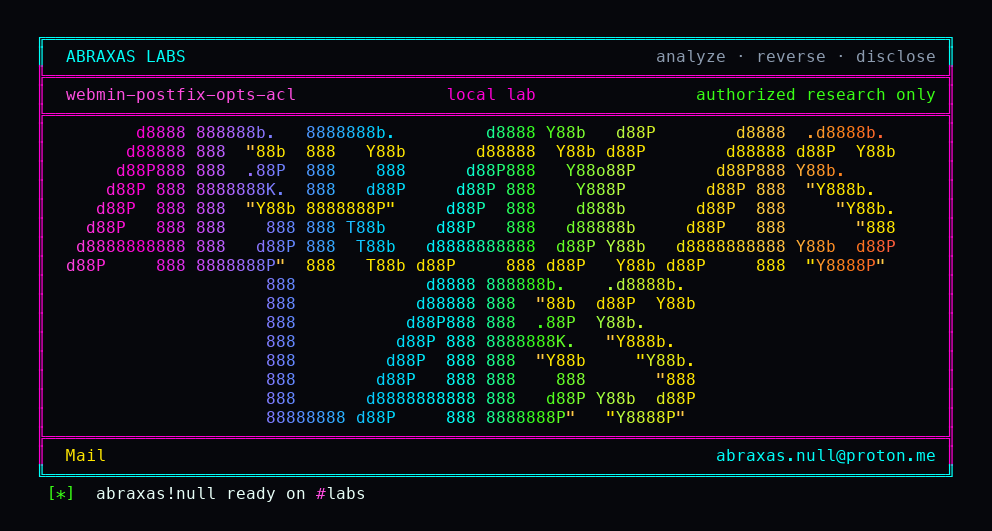

<p align="center">
  
</p>

# webmin-postfix-opts-acl

Webmin will give a helpdesk account the Postfix module and then uncheck the boxes that say "edit general options" and "start or stop Postfix." That account still cannot open the General Options page. It can still POST the same knobs to a different CGI, rewrite live `main.cf`, and reload the daemon. The lock is on the form. The save path never asked.

**Class:** ACL bypass
**Reach:** Remote (signed-in Postfix module user with `general=0` and/or `startstop=0`)

**Webmin** `2.670` (`3a2b2b86`) - Webmin

| | |
|---|---|
| ID | no CVE yet |
| Class | **ACL bypass** |
| Reach | **Remote** (Postfix module user, `general=0` and/or `startstop=0`) |
| CWE | [CWE-285](https://cwe.mitre.org/data/definitions/285.html) |
| CVSS | **High: 8.1** `CVSS:3.1/AV:N/AC:L/PR:L/UI:N/S:U/C:N/I:H/A:H` |
| Product | [Webmin](https://github.com/webmin/webmin) |
| Affected | **2.670** (`3a2b2b8671c0669c129f5275b3dd1853106ae02b`) |
| Auth | signed-in Webmin user who already has the Postfix module. Not unauthenticated. |
| License | [GNU Affero GPL v3.0](LICENSE) |
| Lab | `127.0.0.1:18500` only |

This is not the 2.653 ACL work on DHCPd, MySQL, PostgreSQL, Nginx, Samba, or Squid. Those modules were patched. Postfix `save_opts_misc.cgi` was not in that set.

## What an attacker can do

Needs a Webmin login that already has the Postfix module, with the fine-grained flags `general=0` and/or `startstop=0`. Module grant alone is not the leftover. The leftover is that those flags do not bind the CGI the General Options form posts to.

In ordinary words: the coworker who is allowed to look at the mail queue, but not to change how the mail server is wired, can still change how the mail server is wired.

| Privilege | Method / sink | Recon / integrity / availability | Lab-proven or inferred |
|---|---|---|---|
| Write `mail_name` into live `main.cf` | `POST /postfix/save_opts_misc.cgi` `mail_name_def=` then `save_options` → `postconf -e` | Integrity | Lab-proven. Witness `WEBMIN-H11-POSTFIX-ACL` in `postconf -h mail_name` and `/etc/postfix/main.cf` |
| Write other General Options keys | same CGI, any posted `*_def` (`myorigin`, `mynetworks`, `content_filter`, `queue_directory`, `inet_interfaces`, `relayhost`, …) | Integrity | Inferred. Same `save_options` loop. Lab oracle is `mail_name` |
| Reload Postfix after the write | `reload_postfix` at `save_opts_misc.cgi:33` | Availability | Source. CGI always calls it. Lab oracle is the config write |
| Negative: open the General Options form | `GET /postfix/general.cgi` | n/a | Lab-proven denied. Body contains `You are not allowed to edit General Options` |
| Negative: the sibling save CGI | `POST /postfix/save_opts.cgi` | n/a | Lab-proven denied. `mail_name` unchanged |

**Stays closed on this leftover**

| Axis | Method / sink | Why it is closed |
|---|---|---|
| Integrity | `POST /postfix/save_opts.cgi` | `$access{'general'}` at line 16 |
| Recon | `GET /postfix/general.cgi` | `$access{'general'}` at line 16 |
| Availability | `reload.cgi` / `start.cgi` / `stop.cgi` | `$access{'startstop'}` |
| Integrity | Other `save_opts_*.cgi` (canonical, virtual, header, body, …) | Each checks its own ACL flag |
| Recon | Anonymous miniserv | Needs a `sid` |
| Integrity | Modules patched in 2.653 | DHCPd / MySQL / PostgreSQL / Nginx / Samba / Squid. Not this CGI |
| Integrity | Host shell without a Postfix grant | Out of class. Policy says module grant is not a bug |

`postconf -e` quotemetas the value. This is not command injection. It is a write of Postfix configuration the ACL said this user must not make, followed by a reload the ACL said this user must not run.

## How I found it

I pinned [webmin/webmin](https://github.com/webmin/webmin) **2.670** (`3a2b2b8671c0669c129f5275b3dd1853106ae02b`). The KEEP bar on this tree is a signed-in user the fine-grained ACL already refused. `general.cgi:16` and `save_opts.cgi:16` both refuse `$access{'general'}`. `reload.cgi:9` refuses `$access{'startstop'}`. [`save_opts_misc.cgi`](https://github.com/webmin/webmin/blob/2.670/postfix/save_opts_misc.cgi) does not mention `%access`. It still calls `save_options` (`postfix-lib.pl:644`) then `reload_postfix` (`postfix-lib.pl:315`). `general.cgi` is the form that posts there.

Wrong turns already recorded: treating `save_opts.cgi` as the whole save surface (it is closed); treating a denied General Options page as proof the knobs cannot move; folding this into the 2.653 module list; treating "has the Postfix module" as the bug (the policy says that is why ACLs exist); a reverse shell. Theatre.

## Lab

```bash
python3 webmin-postfix-opts-acl-Abraxas-Labs.py
```

or:

```bash
cd lab
./run.sh
```

`run.sh` clones [webmin/webmin](https://github.com/webmin/webmin) at `3a2b2b8671c0669c129f5275b3dd1853106ae02b` into `lab/src`, builds image `webmin-lab:2.670`, and talks to `http://127.0.0.1:18500`. Docker, git, python3. The image installs Postfix. Loopback only. The launcher `chdir`s into `lab/` and execs `run.sh`.

A `limited` user has the Postfix module with `general=0` and `startstop=0`. `GET general.cgi` is denied. `POST save_opts.cgi` is denied and `mail_name` stays `Postfix`. `POST save_opts_misc.cgi` with `mail_name_def=WEBMIN-H11-POSTFIX-ACL` returns 302 and writes the witness into `main.cf`.

```text
IOC limited-acl general=0 startstop=0
IOC general.cgi status=200 denied=1
IOC save_opts.cgi status=200 denied=1 redirect=
IOC after-denied-mail_name=Postfix witness=0
IOC save_opts_misc.cgi status=302 location=http://127.0.0.1:18500/postfix/ error=0
IOC after-mail_name=WEBMIN-H11-POSTFIX-ACL main.cf=1
SUCCESS WEBMIN-H11-POSTFIX-ACL WEBMIN-H11-POSTFIX-ACL
```

## The fix

At the top of `save_opts_misc.cgi`, refuse unless `$access{'general'}` and `$access{'startstop'}` are both true, the same way `save_opts.cgi` and `reload.cgi` already do. The form on `general.cgi` is not an access check.

## References

- [github.com/webmin/webmin](https://github.com/webmin/webmin) tag [2.670](https://github.com/webmin/webmin/releases/tag/2.670) (`3a2b2b8671c0669c129f5275b3dd1853106ae02b`)
- [`postfix/save_opts_misc.cgi`](https://github.com/webmin/webmin/blob/2.670/postfix/save_opts_misc.cgi)
- [`postfix/general.cgi`](https://github.com/webmin/webmin/blob/2.670/postfix/general.cgi)
- [`postfix/save_opts.cgi`](https://github.com/webmin/webmin/blob/2.670/postfix/save_opts.cgi)
- [`postfix/reload.cgi`](https://github.com/webmin/webmin/blob/2.670/postfix/reload.cgi)
- [`postfix/postfix-lib.pl`](https://github.com/webmin/webmin/blob/2.670/postfix/postfix-lib.pl) (`save_options`, `set_current_value`, `reload_postfix`)
- [CWE-285](https://cwe.mitre.org/data/definitions/285.html)

## License

GNU Affero GPL v3.0. See [LICENSE](LICENSE). Loopback lab only. No warranty.

Abraxas Labs
abraxas.null@proton.me
